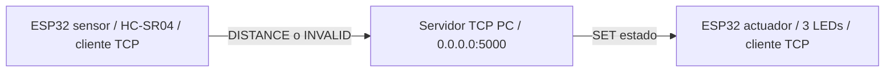
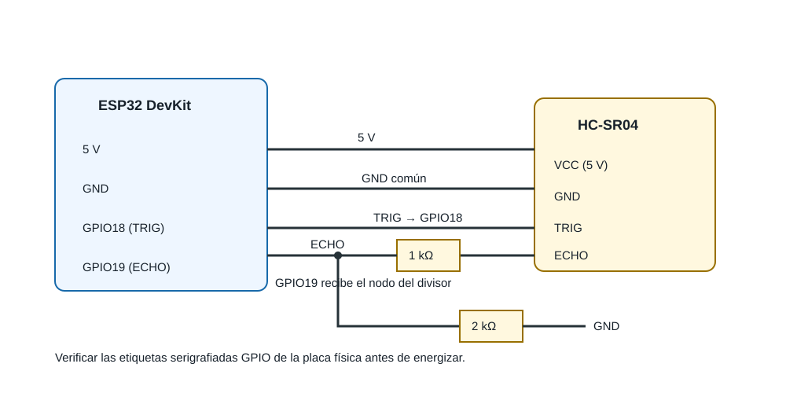
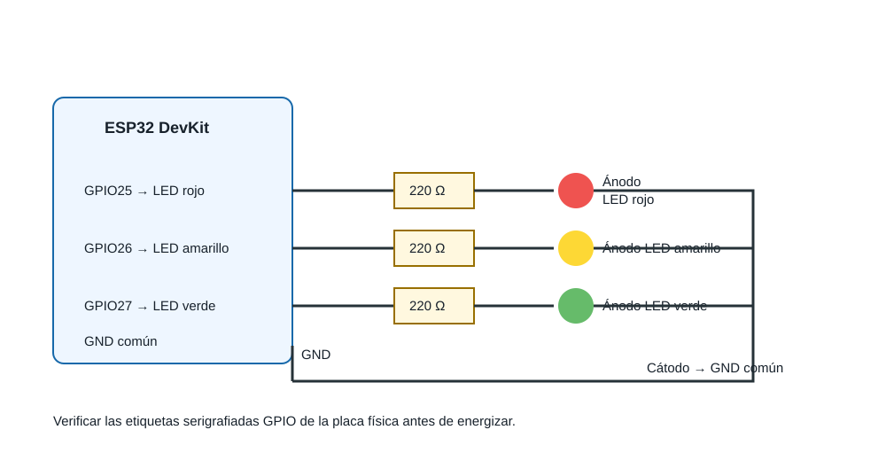
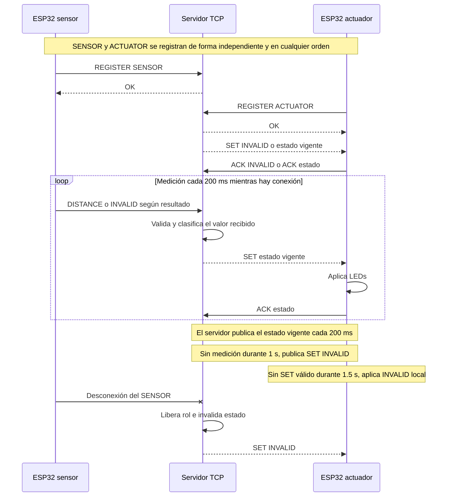
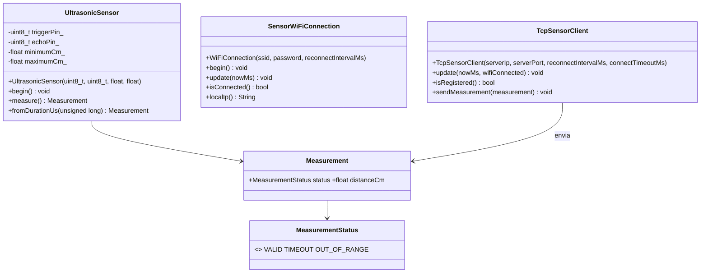
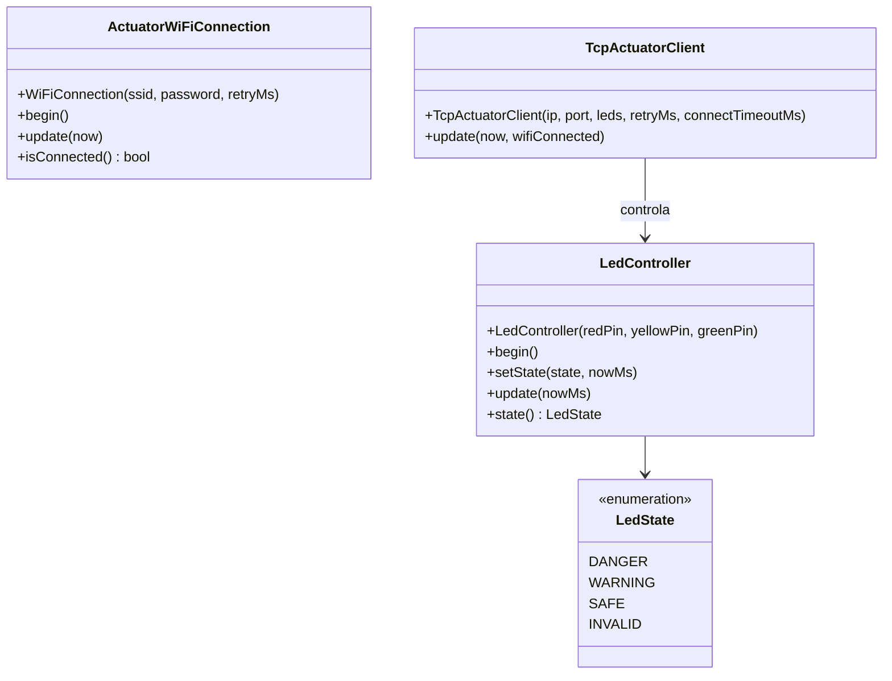
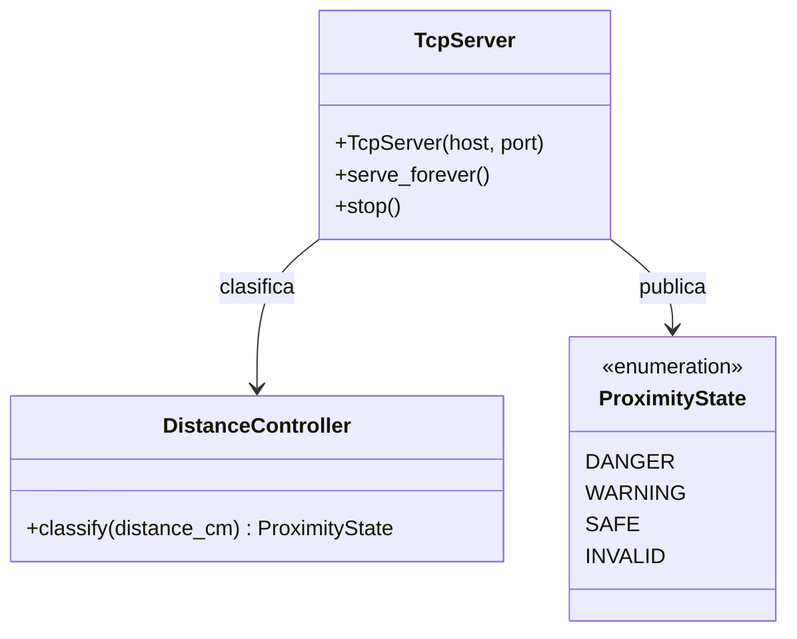

# Informe técnico — Práctica 2

> **Estado del documento:** los firmwares de sensor y actuador, incluidos WiFi/TCP, están implementados y su compilación PlatformIO normal fue verificada el 13 de octubre de 2026. El servidor TCP cuenta con validación automatizada local. Los once CSV de `tests/evidence/` son los registros oficiales de las pruebas físicas, según confirmación del equipo. Unity en placa y evidencias complementarias no incluidas en el repositorio no se declaran disponibles.

## Integrantes y responsabilidades

| Área de trabajo | Evidencia disponible |
|---|---|
| ESP32 sensor | Código fuente, pruebas Unity previstas y CSV de RF1, RNF2 y RNF4. |
| ESP32 actuador | Código fuente y CSV de RF3. |
| Servidor TCP | Código fuente, suite pytest y CSV de RF2, RF4, RF6 y RF7. |

Las fuentes disponibles no vinculan estas áreas con integrantes identificados individualmente. La asignación nominal y su respaldo en el historial de commits deben completarse por el equipo antes de la defensa, sin atribuir responsabilidades no documentadas.

## 1. Requerimientos funcionales y no funcionales

| ID | Requisito | Responsable | Prueba prevista | Estado |
|---|---|---|---|---|
| RF1 | Medir distancia con HC-SR04 en cm. | ESP32 sensor | M-02, M-03, M-06, M-09 | Cumplido: código de adquisición y 60 registros en `sensor/RF1_medicion_distancia.csv`; la exactitud se respalda específicamente en RNF2. |
| RF2 | El servidor clasifica sin redondear: DANGER `[2,20)`, WARNING `[20,50)`, SAFE `[50,100]`; fuera de rango es INVALID. | Servidor TCP | M-02 | Cumplido: 11 casos coincidentes, incluidos 2, 20, 50, 100 y valores fuera de rango, en `tcp/RF2_clasificacion_servidor.csv`. |
| RF3 | El actuador representa solo el `SET` recibido: rojo 150/150 ms, amarillo 500/500 ms, verde fijo; INVALID apaga todos. | ESP32 actuador | M-02, M-04, M-05, M-08, M-09 | Cumplido: cuatro estados registrados con comandos, ACK y exclusividad en `actuator/RF3_actuador_estados.csv`. |
| RF4 | Sensor y actuador se conectan por WiFi al servidor mediante TCP y el protocolo definido. | Tres componentes | M-01, M-05, M-08, M-11 | Cumplido: secuencia de cinco mensajes de registro, distancia, SET y ACK en `tcp/RF4_comunicacion_tcp.csv`. |
| RF5 | La operación debe continuar durante muestreo y parpadeo. | Sensor y actuador | M-04, M-05, M-07 | Cumplido: siete observaciones de 0 a 30 s registran 5 lecturas/s y parpadeo sin bloqueo en `stability/RF5_operacion_continua.csv`. |
| RF6 | El servidor es la única autoridad de clasificación; el sensor informa y el actuador no reclasifica. | Servidor TCP | M-01, M-02 | Cumplido: tres entradas muestran al servidor como autoridad y al actuador aplicando `SET` en `tcp/RF6_autoridad_clasificacion.csv`. |
| RF7 | Mensaje malformado: responder `ERROR <reason>`, registrar el evento, conservar conexión y no ejecutar acción. | Servidor TCP | M-11 | Cumplido: seis mensajes inválidos documentan ERROR, conexión conservada y recuperación en `tcp/RF7_mensajes_malformados.csv`. |
| RNF1 | Estabilidad: operación continua por al menos 10 min sin reinicio ni bloqueo. | Tres componentes | M-07 | Cumplido: registro hasta 600 s sin reinicios, bloqueos ni desconexiones no recuperadas en `stability/RNF1_estabilidad_10min.csv`. |
| RNF2 | Exactitud: error máximo ≤ ±3 cm dentro de 2–100 cm frente a referencia física. | ESP32 sensor | M-03 | Cumplido: 50 mediciones; error absoluto máximo 0,66 cm en `accuracy/RNF2_exactitud.csv`. |
| RNF3 | Respuesta extremo a extremo ≤ 1 s, sensor → servidor → actuador. | Tres componentes | M-08 | Cumplido: 10 transiciones; latencia total entre 40 y 72 ms en `latency/RNF3_latencia_extremo_a_extremo.csv`. |
| RNF4 | Frecuencia objetivo de 5 lecturas/s (una lectura cada 200 ms); supera la referencia docente de ≥ 2 lecturas/s. | ESP32 sensor | M-06 | Cumplido: 307 intentos en 60 s, promedio 5,117 intentos/s, en `sampling/RNF4_frecuencia_muestreo.csv`. |

Las fronteras son contiguas: 2,00 cm y 100,00 cm son válidas; 20,00 cm es WARNING y 50,00 cm es SAFE. No se redondea antes de clasificar. Los estados de la tabla se fundamentan en el código, las validaciones automatizadas ejecutadas localmente y los CSV físicos confirmados por el equipo; esta revisión no reprodujo el montaje ni los ensayos físicos.

## 2. Análisis y diseño

El sensor mide y comunica `DISTANCE` o `INVALID`; el servidor valida, clasifica, registra y envía `SET`; el actuador únicamente traduce el comando válido a LEDs. Ambos clientes reintentan conectar cada 2 s. Ante ausencia de datos del sensor durante 1 s, el servidor envía `SET INVALID` y publica el estado vigente cada 200 ms. Si el actuador no recibe comandos por 1,5 s, adopta INVALID local y apaga LEDs.

### 2.1 Arquitectura general del sistema

### 2.2 Circuito del ESP32 sensor con HC-SR04

El diagrama identifica conexiones lógicas; antes de energizar se deben verificar las etiquetas GPIO serigrafiadas del modelo físico de ESP32 DevKit utilizado.

### 2.3 Circuito del ESP32 actuador con tres LEDs

El ánodo de cada LED queda hacia su resistencia de 220 Ω y el cátodo hacia GND común. Las etiquetas GPIO deben verificarse en la placa antes del montaje.

### 2.4 Diagrama de secuencia de comunicación TCP

El `OK` precede al `SET` inicial del ACTUATOR. El servidor envía el estado vigente al registrar ese rol, incluso si el SENSOR aún no se registró. Las respuestas `ACK` son informativas; la publicación periódica no espera ni reintenta un ACK.

### 2.5 Diagrama de clases del sistema

Los tres diagramas reflejan clases implementadas. `SensorWiFiConnection` y `ActuatorWiFiConnection` representan dos implementaciones homónimas ubicadas en proyectos distintos; no son una clase compartida. Los atributos privados se omiten deliberadamente cuando no son necesarios para explicar relaciones públicas.

Todos los clientes TCP, el actuador y el servidor están implementados. La compilación normal de ambos firmwares fue verificada el 13 de octubre de 2026; los registros de pruebas físicas están organizados en `tests/evidence/` y la ejecución Unity en placa sigue pendiente.

### 2.6 Configuración TCP y WiFi local

El servidor Python escuchará en `0.0.0.0:5000`; `0.0.0.0` permite aceptar conexiones de la red local, pero los ESP32 deben conectarse a la **dirección IPv4 local de la PC**, nunca a `0.0.0.0`. Esa IP no se fija en el código ni se asocia a una red específica. En Windows se obtiene con `ipconfig`, identificando la dirección IPv4 del adaptador WiFi conectado; en otra plataforma se debe consultar la IPv4 de su interfaz WiFi activa. Si cambia la red o la IP, se actualiza la configuración local de ambos ESP32 antes de cargar el firmware.

Cada integrante prepara su archivo local ignorado por Git en **ambos** proyectos: `ESP32 sensor/include/WiFiSecrets.h` y `ESP32 actuador/include/WiFiSecrets.h`. Para cada uno, copiar su `WiFiSecrets.example.h`, configurar `kWifiSsid`, `kWifiPassword` y `kServerIp` con la IPv4 local real de la PC (nunca `0.0.0.0`), mantener `kServerPort = 5000` y cambiar `kUsingExampleWiFiSecrets` de `true` a `false`. Antes de cargar el firmware, comprobar que los dos ESP32 tienen exactamente la misma IPv4 y el puerto `5000`. `WiFiSecrets.h` está ignorado por Git y no debe añadirse al repositorio ni a evidencias. En Windows, obtener la IPv4 con `ipconfig` en el adaptador WiFi activo; si cambia la red o la IP, actualizar los dos archivos locales.

El firmware conserva `__has_include`: si no existe `WiFiSecrets.h`, usa la plantilla versionada, que solo contiene marcadores `REPLACE_WITH_...`, no secretos, y deja `kUsingExampleWiFiSecrets = true`. En esa modalidad el firmware compila y mantiene sus funciones locales, pero intencionalmente no inicia WiFi ni TCP. Con un `WiFiSecrets.h` local completo y la bandera en `false`, inicia la conexión WiFi/TCP con los valores configurados. Esta comprobación de las dos modalidades se realiza sin hardware con `tests/automated/check_wifi_secrets_config.py`; la conectividad real se valida únicamente durante las pruebas físicas finales.

### 2.7 Protocolo de aplicación

Transporte: TCP sobre WiFi. El servidor escucha en el puerto `5000`. Cada mensaje es una línea de texto UTF-8 terminada en `\n`; se acepta `\r\n` eliminando el `\r` final antes de interpretar la línea. Cada línea tiene un máximo de 128 bytes. Si se supera el máximo, el servidor descarta bytes hasta el siguiente `\n`, responde `ERROR INVALID_FORMAT`, registra el evento y conserva la conexión. Un cliente se identifica primero con `REGISTER SENSOR` o `REGISTER ACTUATOR`; el servidor responde `OK`. Solo se admite un cliente por rol; un segundo cliente del mismo rol se rechaza.

| Emisor → receptor | Mensaje | Significado |
|---|---|---|
| Cliente → servidor | `REGISTER SENSOR` / `REGISTER ACTUATOR` | Registro del rol. Al actuador se le entrega el estado vigente. |
| Sensor → servidor | `DISTANCE <valor>` | Distancia en centímetros: entero o decimal con punto y hasta dos cifras decimales. No se redondea antes de clasificar. |
| Sensor → servidor | `INVALID` | No hay eco o la lectura física no es válida. |
| Servidor → actuador | `SET DANGER` / `SET WARNING` / `SET SAFE` / `SET INVALID` | Estado calculado exclusivamente por el servidor. |
| Actuador → servidor | `ACK <estado>` | Confirmación informativa e idempotente de `DANGER`, `WARNING`, `SAFE` o `INVALID`; el servidor conserva el último `SET` y el último `ACK` para trazabilidad, sin retransmisión ni transición de estado. |
| Servidor → cliente | `OK` | Operación de registro aceptada. |
| Servidor → cliente | `ERROR INVALID_COMMAND` | Comando no reconocido. |
| Servidor → cliente | `ERROR INVALID_DISTANCE` | Valor de `DISTANCE` ausente, no numérico, no finito, con coma o con más de dos cifras decimales. |
| Servidor → cliente | `ERROR INVALID_FORMAT` | Línea incompleta o con formato no válido. |

La gramática del valor es `entero` o `entero.decimal`, con uno o dos dígitos decimales como máximo; el separador es siempre punto. Ejemplos válidos: `2`, `20.5`, `100.00`. Ejemplos que responden `ERROR INVALID_DISTANCE`: `20,5`, `20.123`, `NaN` y `DISTANCE` sin valor. Una distancia numéricamente válida pero fuera de `[2,100]`, como `1.99` o `100.01`, produce `SET INVALID`, no `ERROR INVALID_DISTANCE`.

Antes de registrarse, un cliente no puede enviar comandos de su rol. El registro repetido, mensajes de rol incorrecto —por ejemplo, `DISTANCE` recibido desde ACTUATOR o `ACK` desde SENSOR—, comandos previos al registro y `ACK` con un estado que no pertenece al conjunto definido responden `ERROR INVALID_COMMAND`, se registran y no ejecutan acción. Un `ACK` válido se conserva junto al último `SET`; si ambos difieren, se registra una advertencia porque puede corresponder a una publicación periódica anterior, sin cerrar la conexión ni cambiar el estado. `ERROR INVALID_FORMAT` se reserva para una línea que no respeta la estructura general del protocolo. Un error no modifica el estado y la conexión permanece abierta.

Al iniciar, el estado del servidor es `INVALID`; por tanto, un ACTUATOR que se registre antes de la primera medición recibe `SET INVALID`. Al cerrarse una conexión, el servidor libera inmediatamente el rol asociado. Si era el SENSOR, invalida inmediatamente el estado y publica `SET INVALID` al actuador conectado. Un ACTUATOR que se registre después recibe el estado vigente, incluido INVALID. La máquina de estados de registro y limpieza está en [diagramas/arquitectura.md](diagramas/arquitectura.md#registro-y-limpieza-de-conexión).

### 2.8 Hardware y seguridad eléctrica

El HC-SR04 se alimentará con VCC de 5 V y GND común con el ESP32; TRIG se conecta a GPIO18. Como ECHO puede entregar 5 V, se requiere el divisor: **ECHO → 1 kΩ → GPIO19** y **GPIO19 → 2 kΩ → GND**. En el actuador, rojo, amarillo y verde usarán GPIO25, GPIO26 y GPIO27 respectivamente; cada LED tendrá resistencia de 220 Ω y cátodo a GND. El montaje real, fotos y mediciones se conservarán como evidencia; este documento no afirma que exista un montaje probado.

### 2.9 Diseño estructural implementado

Los clientes WiFi/TCP de Sensor y Actuador, `TcpServer`, `DistanceController` y el parser están implementados. Los diagramas muestran únicamente operaciones públicas verificadas en el código; no atribuyen firmas ni atributos inexistentes.

## 3. Desarrollo e implementación

La primera etapa del sensor se implementó en `ESP32 sensor/`. [UltrasonicSensor.h](ESP32%20sensor/include/UltrasonicSensor.h) define una clase reutilizable que recibe GPIO18 (TRIG), GPIO19 (ECHO) y el rango inclusivo 2–100 cm por constructor. [UltrasonicSensor.cpp](ESP32%20sensor/src/UltrasonicSensor.cpp) genera el pulso TRIG, espera el eco con `pulseIn(..., 30000)`, convierte con `duración_us / 58.0` y distingue `VALID`, `TIMEOUT` y `OUT_OF_RANGE`.

El servidor se implementó en `Server TCP/`: `TcpServer` gestiona conexiones concurrentes, registro por rol, buffers de líneas UTF-8, límite de 128 bytes, desconexiones, publicación cada 200 ms y expiración a un segundo. `DistanceController` clasifica sin redondear; `protocol.py` valida mensajes y `config.py` concentra parámetros. La escritura por socket se serializa y el listener se puede detener sin dejar `accept()` bloqueado. La suite pytest se ejecutó localmente en el entorno aislado `Server TCP/.venv`: **24 pruebas aprobadas** el 12 de octubre de 2026.

[main.cpp](ESP32%20sensor/src/main.cpp) inicia Serial a 115200 baudios y programa un intento cada 200 ms mediante `millis()`. Coordina [WiFiConnection](ESP32%20sensor/include/WiFiConnection.h), que solicita WiFi de forma no bloqueante y reintenta cada 2 s, y [TcpSensorClient](ESP32%20sensor/include/TcpSensorClient.h), que intenta TCP con timeout de 100 ms, envía `REGISTER SENSOR`, espera `OK` y recién entonces transmite `DISTANCE <valor>` o `INVALID`. Tras caída WiFi/TCP se descarta el registro y se repite el ciclo de conexión/registro. El receptor del cliente separa líneas `\n` fragmentadas o acumuladas y descarta una respuesta mayor de 128 bytes. La distancia se trunca a dos decimales antes de serializarse; el servidor clasifica exactamente ese valor recibido y no vuelve a redondearlo. Por ello, cerca de 20 y 50 cm la clasificación corresponde al valor truncado transmitido, y las pruebas físicas deben conservar tanto la lectura local como la línea `DISTANCE` enviada. El sensor no clasifica DANGER/WARNING/SAFE. `main.cpp`, no una clase de red, coordina ambas instancias con `wifiConnected`.

El montaje obligatorio conserva el divisor de protección: **ECHO → 1 kΩ → GPIO19** y **GPIO19 → 2 kΩ → GND**, con GND común y VCC del HC-SR04 a 5 V. La compilación no valida por sí sola el montaje ni la medición física; los registros CSV de las pruebas físicas se conservan en `tests/evidence/` y no sustituyen evidencias complementarias que no estén disponibles.

El actuador se implementó en `ESP32 actuador/`: `LedController` recibe GPIO25, GPIO26 y GPIO27 por constructor, inicia en `INVALID`, mantiene exclusividad y usa `millis()` para rojo 150/150 ms y amarillo 500/500 ms sin reiniciar fase ante un `SET` repetido. `TcpActuatorClient` registra `REGISTER ACTUATOR`, espera `OK`, acepta solo `SET DANGER|WARNING|SAFE|INVALID`, aplica el estado y envía `ACK` después. Si pierde WiFi/TCP o pasan 1,5 s sin `SET` válido, ordena `INVALID`; reintenta cada 2 s. Su `WiFiSecrets.example.h` contiene el marcador `REPLACE_WITH_PC_IPV4`, no una IPv4 real: se completa únicamente en el `WiFiSecrets.h` local ignorado siguiendo la configuración común de ambos ESP32. La compilación normal PlatformIO verificada el 13 de octubre de 2026 terminó correctamente (RAM 7,7 %, flash 27,8 %); los resultados de pruebas físicas disponibles se registran en los CSV de `tests/evidence/`, mientras que Unity en placa sigue pendiente.

## 4. Pruebas y validaciones

Los procedimientos M-01 a M-11, sus criterios y sus evidencias esperadas están en [tests/manual/README.md](tests/manual/README.md). Los resultados físicos confirmados por el equipo se conservan en los once CSV inventariados en [tests/evidence/README.md](tests/evidence/README.md). Las métricas siguientes se calcularon a partir de esos archivos; no se añadieron resultados que no figuren en ellos.

| Alcance | Registro | Resultado resumido |
|---|---|---|
| Medición de distancia (RF1) | [RF1_medicion_distancia.csv](tests/evidence/sensor/RF1_medicion_distancia.csv) | 60 lecturas en referencias de 2, 10, 20, 50, 75 y 100 cm; 54 se registran como VALID y 6 como OUT_OF_RANGE. El mayor error absoluto registrado es 0,45 cm. |
| Clasificación (RF2) | [RF2_clasificacion_servidor.csv](tests/evidence/tcp/RF2_clasificacion_servidor.csv) | 11 de 11 casos coinciden con el estado esperado, incluidos los límites 2, 20, 50 y 100 cm. |
| Actuación (RF3) | [RF3_actuador_estados.csv](tests/evidence/actuator/RF3_actuador_estados.csv) | DANGER: 152/149 ms; WARNING: 503/498 ms; SAFE fijo e INVALID apagado. Los cuatro registros incluyen el ACK correspondiente y exclusividad de LEDs. |
| Flujo TCP y autoridad (RF4, RF6) | [RF4_comunicacion_tcp.csv](tests/evidence/tcp/RF4_comunicacion_tcp.csv), [RF6_autoridad_clasificacion.csv](tests/evidence/tcp/RF6_autoridad_clasificacion.csv) | Se registran cinco pasos REGISTER/OK/DISTANCE/SET/ACK y tres casos donde el servidor clasifica y el actuador aplica el SET. |
| Continuidad e inválidos (RF5, RF7) | [RF5_operacion_continua.csv](tests/evidence/stability/RF5_operacion_continua.csv), [RF7_mensajes_malformados.csv](tests/evidence/tcp/RF7_mensajes_malformados.csv) | Siete observaciones de operación continua sin bloqueo y seis mensajes inválidos con ERROR, conexión conservada y recuperación posterior. |
| Estabilidad (RNF1) | [RNF1_estabilidad_10min.csv](tests/evidence/stability/RNF1_estabilidad_10min.csv) | 11 puntos desde 0 hasta 600 s; las columnas registran cero reinicios, bloqueos y desconexiones no recuperadas. |
| Exactitud (RNF2) | [RNF2_exactitud.csv](tests/evidence/accuracy/RNF2_exactitud.csv) | 50 mediciones en 10, 20, 50, 75 y 100 cm; máximo error absoluto 0,66 cm y promedio 0,345 cm, bajo el límite de 3 cm. |
| Latencia (RNF3) | [RNF3_latencia_extremo_a_extremo.csv](tests/evidence/latency/RNF3_latencia_extremo_a_extremo.csv) | 10 transiciones; mínimo 40 ms, máximo 72 ms y promedio 59,5 ms, frente al límite de 1000 ms. |
| Muestreo (RNF4) | [RNF4_frecuencia_muestreo.csv](tests/evidence/sampling/RNF4_frecuencia_muestreo.csv) | 307 intentos en 60 s: 305 válidos, 2 inválidos y promedio de 5,117 intentos/s. |

La validación automatizada ejecutada localmente comprende 24 pruebas pytest aprobadas para clasificación, parser, registro de roles, fragmentación, expiración, reconexión y mensajes inválidos. La compilación normal de ambos firmwares fue verificada el 13 de octubre de 2026. Estas comprobaciones son distintas de los resultados físicos: las primeras fueron ejecutadas localmente durante la revisión; los CSV físicos son registros proporcionados y confirmados por el equipo. Unity en placa y evidencias complementarias no incluidas —por ejemplo, fotos, vídeos o logs crudos— no se declaran disponibles.

## 5. Resultados

### 5.1 Implementación y compilación

El sistema separa adquisición, control y actuación: el ESP32 sensor mide y envía la lectura; el servidor Python valida y clasifica; el ESP32 actuador representa exclusivamente el estado recibido. La compilación normal de ambos proyectos PlatformIO finalizó correctamente.

| Componente | Verificación | Resultado |
|---|---|---|
| Firmware ESP32 sensor | `pio run -e esp32doit-devkit-v1`, 13-Oct-2026 | Exitosa; RAM 7,7 %, flash 27,8 %. |
| Firmware ESP32 actuador | `pio run -e esp32doit-devkit-v1`, 13-Oct-2026 | Exitosa; RAM 7,7 %, flash 27,8 %. |
| Servidor TCP | Suite automatizada pytest | 24 pruebas aprobadas. |
| Pruebas físicas | Once CSV en `tests/evidence/` | Resultados resumidos en §4 y trazados a RF/RNF. |

### 5.2 Análisis de resultados físicos

Los resultados cubren los límites de clasificación y los estados del actuador. En el registro de RF1 aparecen seis lecturas OUT_OF_RANGE alrededor de referencias extremas; el archivo las conserva con su estado original y no identifica su causa. En cambio, el conjunto específico de exactitud RNF2 contiene 50 mediciones dentro de su criterio y un máximo de 0,66 cm. La diferencia evidencia por qué la condición de validez y la exactitud deben analizarse como métricas separadas.

La latencia máxima registrada fue 72 ms, con un margen de 928 ms respecto al límite declarado de 1 s. El muestreo promedió 5,117 intentos/s: supera tanto el objetivo de 5/s como la referencia docente de 2/s, aunque se registraron dos intentos inválidos dentro de los 307 intentos. La estabilidad alcanza exactamente los 600 s declarados sin reinicios, bloqueos ni desconexiones no recuperadas en el CSV correspondiente.

Los registros de TCP documentan tanto el flujo normal como el tratamiento de seis entradas inválidas. El servidor mantiene la conexión y permite una operación válida posterior según esos registros, coherente con el parser y el manejo de roles implementados.

## 6. Conclusiones

La práctica implementa una arquitectura TCP/IP distribuida con responsabilidades separadas: el sensor adquiere y comunica datos, el servidor centraliza la clasificación y el actuador aplica el comando recibido. El código, los diagramas y el protocolo son coherentes con esta separación; el actuador no clasifica distancias y el servidor conserva la autoridad sobre DANGER, WARNING, SAFE e INVALID.

Los registros físicos confirmados por el equipo respaldan los rangos de clasificación, los cuatro estados del actuador, el flujo TCP, la recuperación ante mensajes inválidos y los cuatro atributos no funcionales declarados. En particular, los CSV registran 0,66 cm como error absoluto máximo, 72 ms como latencia máxima, 5,117 intentos/s de promedio y 600 s sin los incidentes contados por la prueba de estabilidad.

Los resultados también muestran lecturas OUT_OF_RANGE y dos intentos inválidos de muestreo. No se eliminan del análisis: confirman que el sistema conserva una ruta explícita para condiciones inválidas. Los CSV disponibles no permiten atribuir una causa física concreta a esas observaciones ni sustituyen evidencias complementarias ausentes.

## 7. Recomendaciones

En futuras ejecuciones se recomienda conservar junto a cada CSV los logs crudos, fotografías o vídeos que el equipo decida producir, identificando versión de firmware, fecha, responsable y condiciones de prueba. Estos elementos complementarían la trazabilidad existente sin reemplazar las filas originales de los CSV.

Debe mantenerse el divisor de tensión ECHO → 1 kΩ → GPIO19 y GPIO19 → 2 kΩ → GND, además de las resistencias de 220 Ω de los LEDs y la tierra común. La verificación visual del montaje debe acompañar cualquier modificación física posterior.

Como mejora futura, las mediciones cercanas a 2, 20, 50 y 100 cm pueden repetirse y conservarse por separado para estudiar la variación alrededor de los límites, sin cambiar la política actual de clasificación. También conviene completar y conservar la ejecución Unity en placa cuando esté disponible.
## 8. Anexos y trazabilidad

| Artefacto | Cubre | Estado |
|---|---|---|
| [Arquitectura y diagramas](diagramas/arquitectura.md) | RF1–RF7, protocolo y hardware | Coherente con el código revisado; el montaje se respalda por confirmación del equipo y CSV, sin fotos incluidas. |
| [Pruebas manuales](tests/manual/README.md) | RF1–RF7, RNF1–RNF4 | Procedimientos documentados; resultados físicos resumidos en §4. |
| [Pruebas automatizadas](tests/automated/README.md) | Sensor, clasificación y protocolo | 24 pruebas pytest ejecutadas localmente; Unity en placa no declarada disponible. |
| [Evidencias](tests/evidence/README.md) | Resultados y trazabilidad | Once CSV de resultados de pruebas físicas, relacionados con RF1–RF7 y RNF1–RNF4. |
